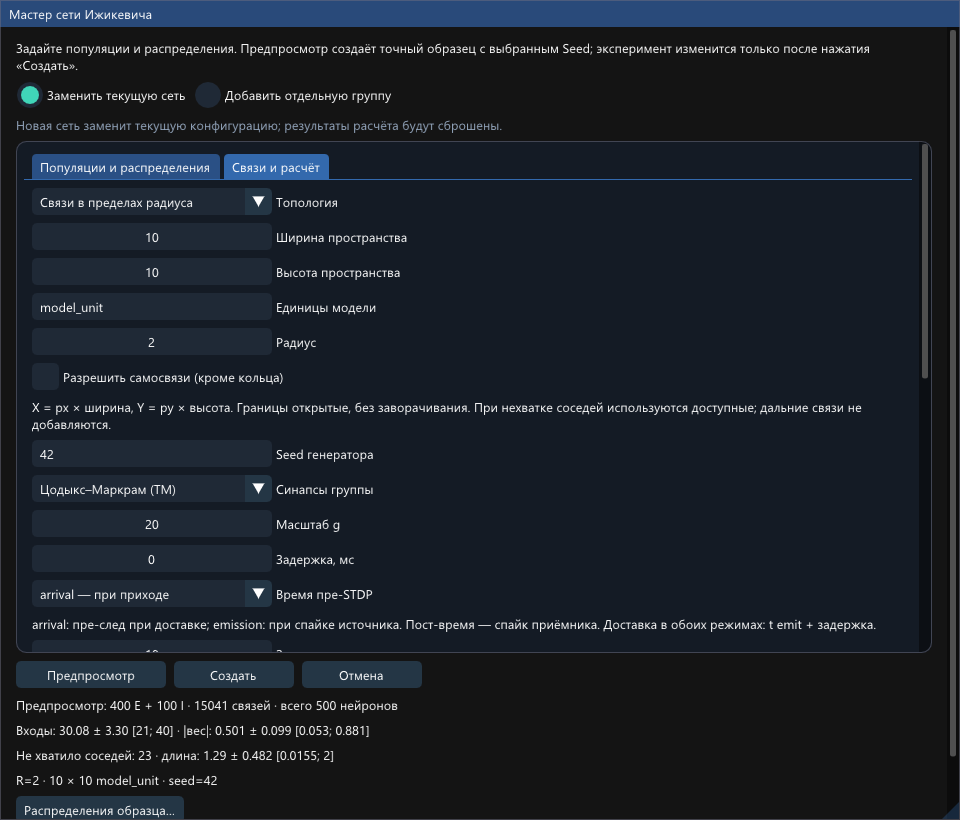
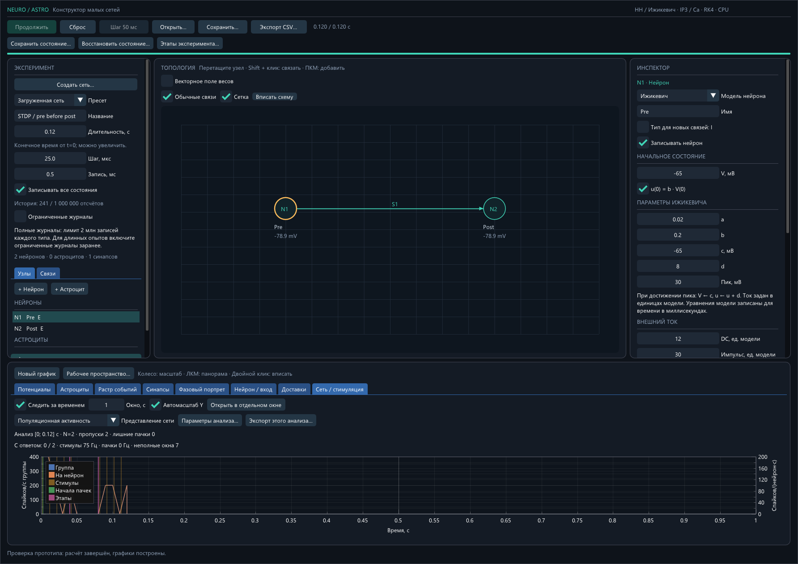
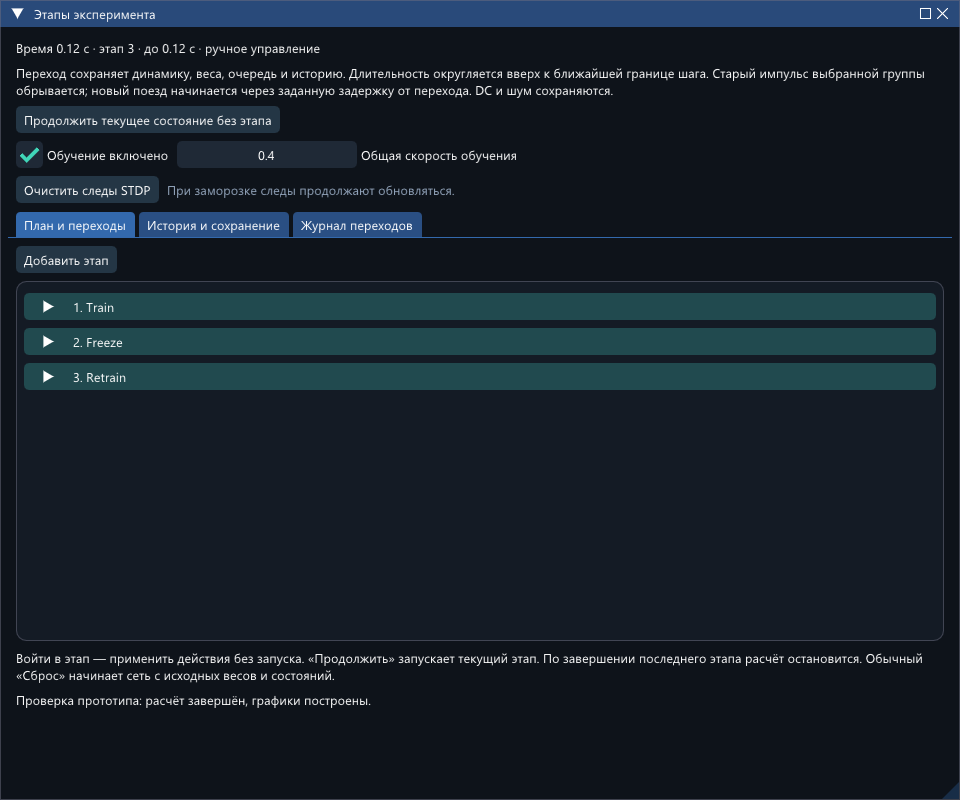

# Проверка пространственной генерации, анализа и этапов

18 октября 2026 года. Ветка `feature/spatial-analysis-stages`, база `27497d6`. Исходное рабочее дерево было чистым. Исторические отчёты не перезаписывались. GUI и CLI собраны в Release без CUDA.

**Реализованы все три функции, но требуемый полный прогон сети 500/≈15 000 на этапах 100–200 секунд не выполнен.** Ни короткие опыты ниже, ни синтетические тесты не заменяют такую проверку. Измеренная стоимость выбранного протокола остаётся ограничением этой CPU-сборки. Это также не отчёт о воспроизведённой синхронизации ЛР6.

## Возможности

- Мастер сети: отдельная топология «Связи в пределах радиуса», размеры и единицы, явные самосвязи, нехватка соседей, статистика/гистограммы. JSON хранит готовый граф и метаданные создания.
- «Сеть / стимуляция»: частота группы и на нейрон, пачки, частота пачек, ответы/задержки, фактические стимулы и таблицы; независимые окна и экспорт параметров каждого анализатора.
- «Этапы эксперимента…»: план, ручной вход/автоматическая последовательность, обучение/коэффициент/очистка следов, протоколы выбранной группы, журнал переходов, независимое продолжение из checkpoint и экспорт обученных весов.
- Ограниченные журналы отделены от живой очереди доставок. Показывается доступный интервал; удалённая история не выдаётся за полный архив.

Управление, определения и порядок ручной ЛР6: [README_RU.md](README_RU.md). Поля и совместимость: [FORMAT_RU.md](FORMAT_RU.md).

## Проверки

| Проверка | Результат |
|---|---|
| `powershell -ExecutionPolicy Bypass -File .\build.ps1 -Test -Smoke` | Все 19 CTest-наборов прошли; 366,58 с на тесты; нативный Smoke прошёл |
| Радиус | Граница включается, самосвязи явные, нет дублей/дальних связей; дефицит, seed и точное JSON roundtrip проверены; прежние режимы проходят |
| Анализ | Известные последовательности, E/I/группа, нормировка и неполные окна; 1/10 Гц с пропуском и лишней пачкой; уникальность сопоставления; равные частоты без совпадения времён |
| Этапы и обучение | Train→Freeze→Retrain; заморозка весов с продолжающимися следами; очистка без сброса весов; коэффициент для трёх правил; сохранение прошлых входов |
| Новый процесс | Непрерывная последовательность и остановка в 0,027 с с загрузкой в другом процессе: побайтово совпали checkpoint и все 13 экспортируемых файлов |
| Ограниченная история | 40 нейронов/1560 связей, задержка 10 мс, 50 000 записей; журнал доставок усечён до границы 0,474795 с, осталось 46 800 записей и 18 720 ожидающих доставок |
| Независимость от хранения | После нормализации только истории/политики хранения checkpoint полного и ограниченного режима совпал побайтово, включая внутреннее состояние решателя; продолжение после усечения до 0,52 с через загрузку также совпало |
| GUI | Реальные ImGui-вводы: заморозка, очистка, создание/вход в этап, настройка независимых анализаторов, предпросмотр радиуса без изменения модели |
| Win32/DX11 | Нативные графики, мастер и отдельное платформенное окно этапов отрисованы и сохранены; существующие проверки multi-viewport и векторного поля прошли |

После полного набора исправлены ширина поля GUI, сообщение о продолжении завершённого этапа и защита привязок графиков при недопустимом черновике. Затем повторно прошли 6 затронутых GUI/workspace-наборов и Smoke; после последней текстовой правки GUI — ещё два затронутых набора. Дополнительный тест хранения/продолжения прошёл за 47,54 с; расширенная проверка всех экспортов в другом процессе — за 2,75 с. Численное ядро после полного набора не менялось.

Логи под `E:/asp/26_27/configurator/verification/spatial_20261018/`:

- `release_validation.log` — полный build/Test/Smoke;
- `final_gui_tests.log`, `documented_release_gui_tests.log` — проверки финальных GUI-правок;
- `retention_final.log` — расширенный контроль ограниченной истории;
- `process_all_exports_final.log` — точное продолжение в новом процессе;
- `documented_release_build.log`, `documented_release_smoke/` — финальная сборка и Smoke.

## Короткий опыт 400 E + 100 I

Seed 706. Пространство 10×10 `model_unit`, радиус 2. Получено **15 013 связей**, входы **30,026 ± 3,02545** (популяционная SD), максимальная длина **1,9998496616**. Целевое распределение |w| — 0,5±0,1; E/I-полярность сохранена. Используются TM, мультипликативная STDP A+=0,001 / A−=0,0012, τ+=τ−=20 мс, границы веса 0…1, нулевая задержка/arrival. Все точные параметры находятся в сохранённых JSON.

Сначала выполнено 0…0,02 с с замороженными весами. Обе ветви загружены из **одного `common.nscp`**; их этапы длились 0,3 с, закончились в абсолютное время 0,32 с. Шаг 50 мкс, запись 2 мс только для шести нейронов/четырёх связей. Новые импульсы: амплитуда 50, ширина 3 мс, первый через 10 мс после перехода. Это сокращённый диагностический вариант, а не 100/200-секундный протокол из примеров.

| Показатель | Номинально 1 Гц | Номинально 10 Гц |
|---|---:|---:|
| Опорные импульсы в коротком интервале | 1: t=0,03 с | 3: t=0,03; 0,13; 0,23 с |
| Спайки за весь опыт 0…0,32 с | 11 697 | 11 504 |
| Изменившиеся веса относительно общего снимка | 11 961 | 11 961 |
| Завершённые / открытые пачки | 1 / 0 | 0 / 1 |
| Подтверждённые ответы / полные окна стимулов | 0 / 1 | 0 / 3 |
| Пропущенные стимулы / лишние завершённые пачки | 1 / 1 | 3 / 0 |
| Время вычисления этапа, wall seconds | 202,581 | 194,602 |

В обеих ветвях крупная начальная пачка начинается в 0,003294934257 с, **до первого стимула**. При 1 Гц она завершилась в 0,253958070 с, при 10 Гц оставалась открытой на правой границе наблюдения. Детектор: W=20 мс, начало 1000/с группы, завершение 250/с, минимум 25 участников, окно ответа 0…80 мс. Параметры не подбирались отдельно под две ветви.

При 1 Гц средняя частота одного стимула и одной завершённой пачки на этом коротком интервале равна 3,125 Гц, но сопоставленных ответов нет. Это демонстрирует, почему совпадения средних частот недостаточно. По столь короткому переходному участку нельзя утверждать ни наличие, ни отсутствие установившейся синхронизации при длительном обучении.

Производительность измерена на Intel Core i9-11900KF 3,50 ГГц, Windows x64, MSVC Release. Две ветви запускались одновременно, параллельно части проверок; это не изолированный бенчмарк. Короткий фон занял 26,9255 с. Ветви показывают около 650–675 wall seconds на модельную секунду этого переходного участка. Линейная экстраполяция на 100–200 с означала бы десятки часов, но нагрузка меняется вместе с активностью, поэтому такая оценка не заменяет измеренный длинный прогон.

Полные настройки на 100/100/200/100 с находятся в [examples/lab6_1hz.json](examples/lab6_1hz.json) и [examples/lab6_10hz.json](examples/lab6_10hz.json); [run_lab6.ps1](run_lab6.ps1) выполняет последовательность и две ветви из общего состояния. **Именно этот полный сценарий пока не проверен выполнением.**

Результаты финальной сборки, общий и конечные checkpoint, все CSV/JSON и архив CLI сохранены в:

`E:/asp/26_27/configurator/verification/spatial_20261018/comparison_release/`

Компактные значения и SHA-256 каждого файла: [short_comparison_release.json](short_comparison_release.json). Воспроизводимый сбор сводки: [summarize_short.py](summarize_short.py). Предварительный прогон в соседнем `comparison/` сохранён отдельно со своей сборкой. Траектории, веса, спайки, доставки и стимулы предварительной и финальной сборок совпали побайтово для обеих ветвей; их checkpoint не взаимозаменяемы из-за строгого отпечатка сборки.

## Ограничения

- Не подтверждены реальные 100–200-секундные и более длинные расчёты на сети 500/15 000. Память ограничена и усечение проверено под нагрузкой, но полной длительной проверки этого размера нет.
- Ограниченный журнал удаляет старые записи. Это не потоковый архив; глубина показана явно. Сохранившиеся состояния, события для интегратора и очередь не сокращаются вместе с архивом.
- Пределы: 1 млн отсчётов/32 млн записанных скаляров, 1 млн ожидающих доставок, 4096 переходов, 200 000 окон анализа. При расширении этапов бюджет записи проверяется на входе в каждый этап.
- Доступный анализ охватывает сохранённый интервал целиком, а не произвольный пользовательский временной срез. Опорный поезд — один выбранный нейрон; отдельного объекта стимулятора пока нет.
- Пространственные единицы и детектор пачек — явно выбранные определения Network Studio. Соответствие `radius=2`, динамике и обучению NeuroNet не установлено. Программные тесты не доказывают биологическую достоверность.

## Сборка

| Файл | SHA-256 |
|---|---|
| `E:/asp/26_27/configurator/build/Release/network_studio.exe` | `e2cd8cc25c2a20fc877b2f1e4c50794e6fb01bacb7ba65cba4699f536a4e7166` |
| `E:/asp/26_27/configurator/build/Release/network_studio_cli.exe` | `659253e6b3e6d1d9ea645236f7df7ba021066e12102135aca815894930156e94` |

Размеры и идентификатор совместимости: [build_manifest.json](build_manifest.json).

## Снимки нативного приложения

Мастер: демонстрационный seed 42; это иллюстрация интерфейса, не граф опыта seed 706.

Сетевой график и границы этапов небольшого проверочного протокола:

Отдельное платформенное окно управления этапами:

