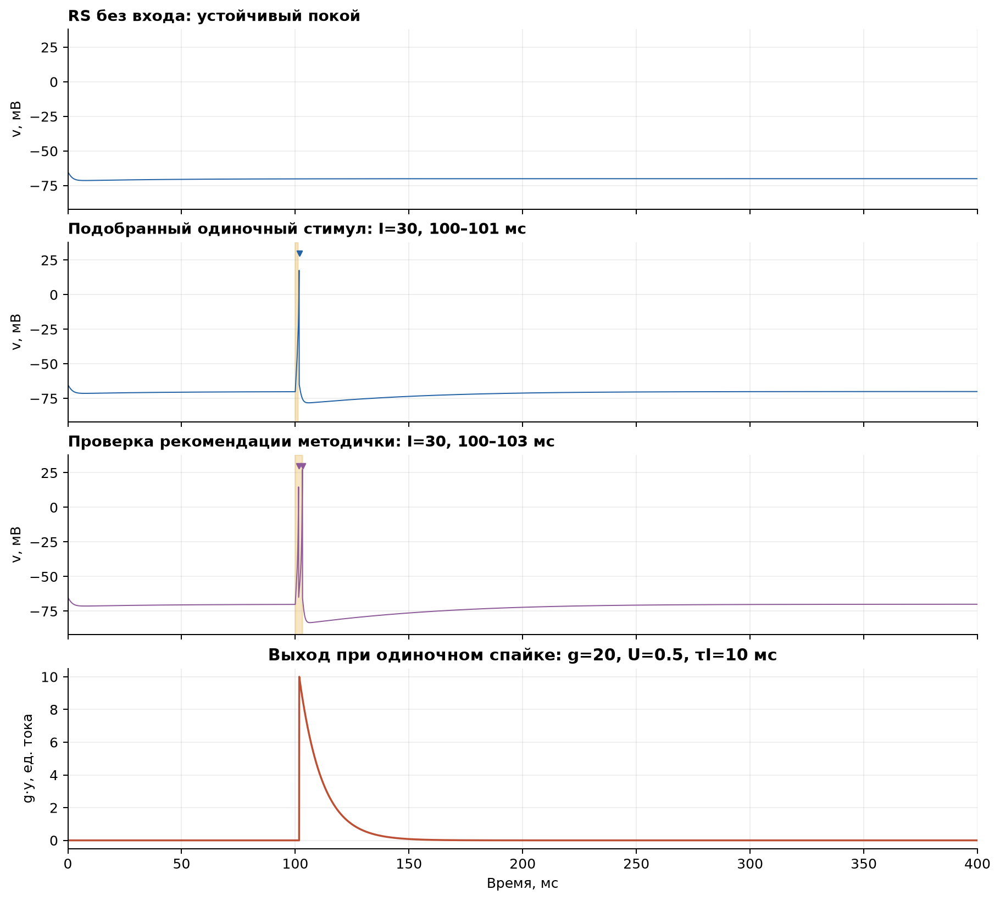
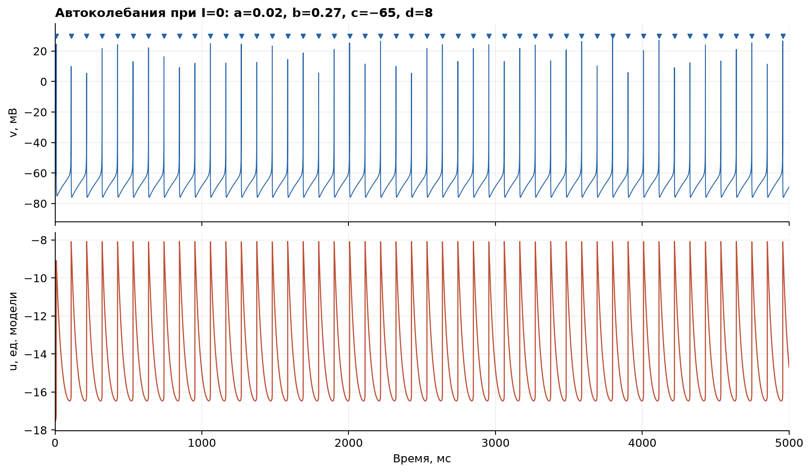
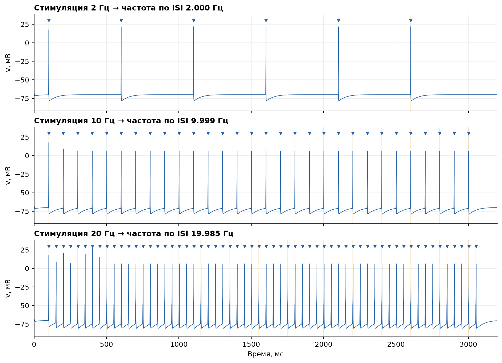
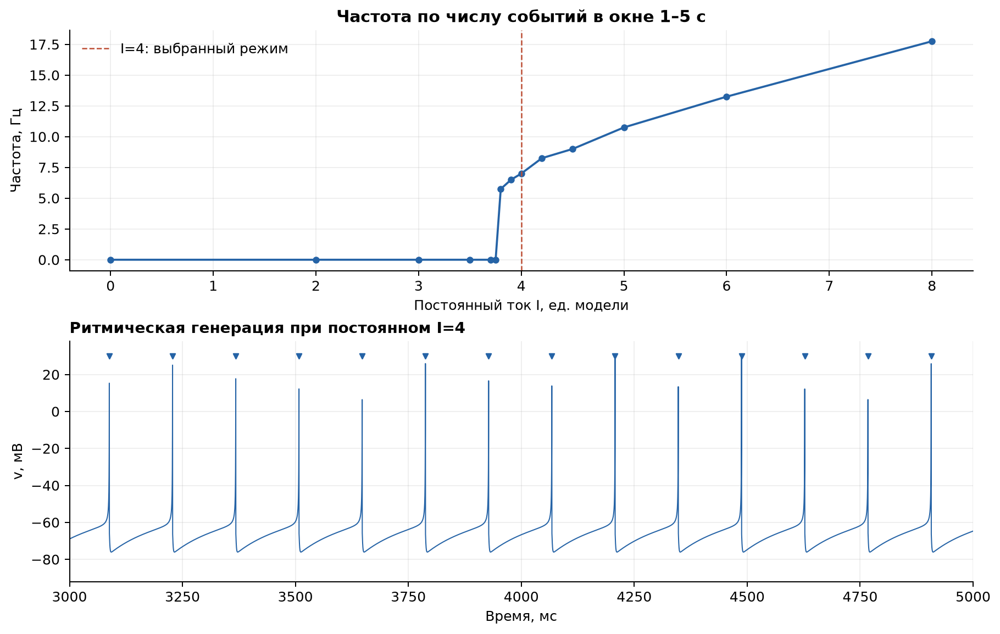
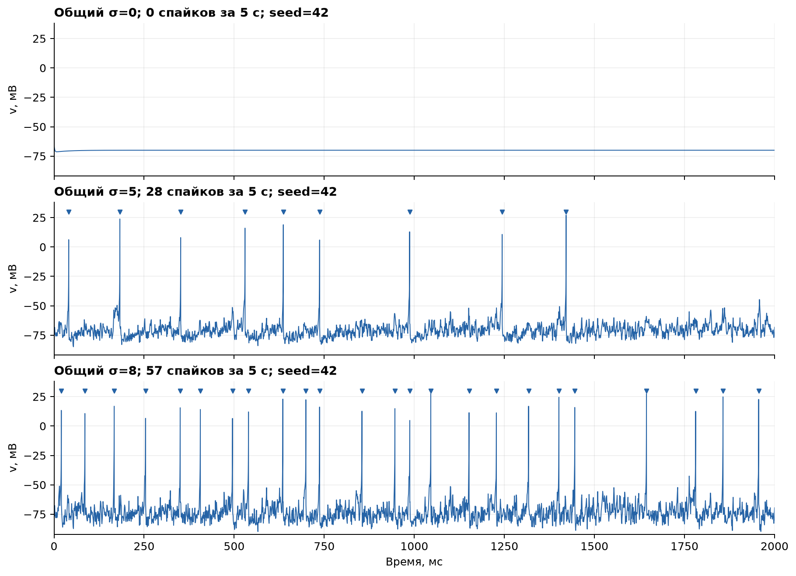
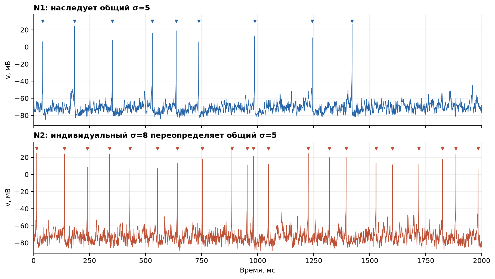
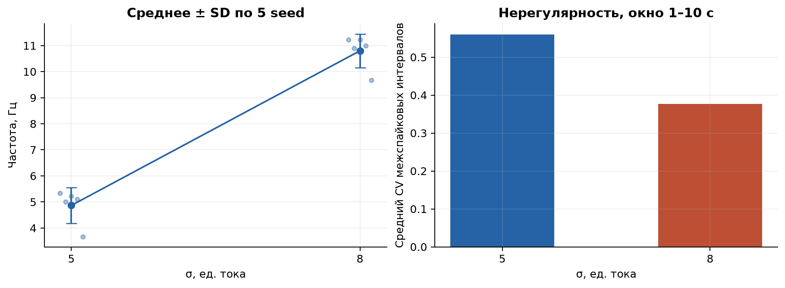

# Лабораторная работа 1: динамика нейрона Ижикевича

Выполнены четыре задания из учебного пособия `UMP_Lobov_i_dr_Neyrokiberneticheskie_printsipy_fin.pdf`, страницы 12–17; уравнения модели и синапса — страницы 5–7. Численные данные основной серии получены исполняемым файлом `network_studio_cli` с тем же C++ ядром, которое использует графический конфигуратор ImGui/ImPlot. Скрипт `reproduce.py` формирует конфигурации, проверяет CSV и строит изображения. Независимые проверки решателей вынесены в отдельные скрипты.

Контрольный опыт в оригинальном **NeuroNet SM R05** объяснил расхождение для периодической стимуляции **30 × 3 мс, 10 Гц**: при `Step=0.500 мс` на Em виден один спайк на импульс, при `Step=0.025 мс` — два, при остальных сохранённых настройках. В этой версии используется явный Эйлер; Network Studio использует RK4 с шагом 0.025 мс. Таким образом, сравнивались разные численные протоколы. Скриншоты пользователя, воспроизводимый расчёт и ограничения сравнения: [проверка NeuroNet](results/neuronet_comparison/README.md). Длительность 1 мс в основной серии ниже — отдельно подобранный стимул для получения одиночных ответов; это изменение исходного протокола, а не буквальное повторение опыта 30 × 3 мс.

## Повторный запуск

Из каталога `network_studio` после сборки:

```powershell
.\build.ps1 -Test
python .\lab1\reproduce.py
```

Нужны Python 3, NumPy и Matplotlib, установленные для той же версии Python. Проверенная здесь среда: Python 3.12.14, NumPy 2.5.3, Matplotlib 3.11.2. Системный Python 3.13 не совместим с подготовленными в этой рабочей папке пакетами для CPython 3.12. Для повторения именно в текущем окружении из каталога `network_studio`:

```powershell
$labPython = Join-Path $env:USERPROFILE '.cache\codex-runtimes\codex-primary-runtime\dependencies\python\python.exe'
& $labPython .\lab1\reproduce.py --python-deps '..\..\..\tmp\python_deps'
```

Путь с дополнительными пакетами подключается только явным ключом `--python-deps`; в обычной установке он не нужен. Альтернативный CLI: `python lab1/reproduce.py --cli path/to/network_studio_cli.exe`. Ключ `--prepare-only` обновляет конфигурации без вычислений, `--skip-run` заново проверяет и визуализирует уже существующие CSV. Для независимой проверки `reference_check.py` дополнительно нужна SciPy; в указанной среде её можно подключить через `PYTHONPATH` к той же папке пакетов.

Каждый JSON из [configs](configs) можно открыть в Network Studio через «Открыть». Для задания 1 выберите `02_single_pulse.json`, для задания 2 — `03_autonomous.json`, для задания 3 — `04_periodic_02hz.json`, `04_periodic_10hz.json`, `04_periodic_20hz.json`, `05_dc_4.json`, для задания 4 — `06_noise_global_*.json` и `07_noise_individual.json`. Нажмите запуск; напряжение видно на вкладке потенциалов, синаптический выход — на вкладке синапсов.

## Модель и договорённости

Уравнения Ижикевича: `dv/dt = 0.04 v² + 5 v + 140 − u + I`, `du/dt = a(bv−u)`. При `v≥30 мВ`: `v←c`, `u←u+d`. В этих уравнениях время измеряется в миллисекундах; ядро хранит секунды и переводит производные множителем 1000. RS: `a=0.02`, `b=0.2`, `c=−65`, `d=8`, `v0=−65`, `u0=b·v0`.

Шаг RK4 — 25 мкс. Напряжение записывается через 100 мкс (одиночный импульс — 50 мкс); момент спайка фиксируется на границе шага. Треугольники на графиках отмечают зарегистрированные события на уровне 30 мВ: пиковое значение после сброса не является состоянием, хранящимся в CSV. Кривые отображают именно записанное состояние. Имена CSV содержат физические единицы, время в CSV — секунды; на рисунках оно переведено в миллисекунды.

Ток измеряется в единицах модели. Методичка называет амплитуду стимулятора «Voltage/мВ», хотя подставляет её в `I` уравнения (1). Рекомендация страницы 16 — прямоугольный импульс 30 продолжительностью 3 мс — проверена отдельными сценариями. В RK4 с указанным шагом она вызывает дублет, что подтверждено независимыми адаптивными решателями. Контроль в NeuroNet показал зависимость числа спайков от шага при периоде 100 мс: одиночный ответ при 0.5 мс и двойной при 0.025 мс. Вывод об ошибочности рекомендации пособия на основании одного сравнения был бы преждевременным. Для одиночного ответа и частот 2/10/20 Гц в основной серии подобрана длительность **1 мс при той же амплитуде 30**. Задание 3 предлагает изменять параметры стимуляции для получения нужной активности. В иллюстрации страницы 15 и описании на странице 16 для другого, 30-миллисекундного примера значения 30 и 20 расходятся; этот неоднозначный пример не использован.

Синапс Цодыкса–Маркрамa: `dx/dt=z/τrec`, `dy/dt=−y/τI`, `du/dt=−u/τfacil`, `z=1−x−y`. При спайке сначала `u←u+U(1−u)`, затем `r=u·x_old`, `x←x−r`, `y←y+r`, как уточнено на странице 23. Ток связи `I_syn=w·g·y`. Для задания 1: `U=0.5`, `τrec=50 мс`, `τI=10 мс`, `τfacil=1000 мс`, `g=20`. Ресурсы нормированы: `x0=1,y0=z0=u0=0`. Это соответствует масштабу `Initial x=20` на скриншоте страницы 13, вынесенному в множитель `g`. Связь с пассивным вторым нейроном имеет малый вес `w=0.01`; она позволяет наблюдать выход и не меняет динамику источника. Астроциты и STDP в ЛР1 не участвуют.

## Задание 1: покой, одиночный спайк и выход

Без внешнего тока RS не генерирует спайков и приближается к устойчивому потенциалу −70 мВ. Подобранный импульс 100–101 мс вызывает ровно один спайк. Синаптический ответ после события затухает с `τI=10 мс`; начальный скачок `g·U·x0=10` единиц тока. Отдельная проверка одиночного импульса 100–103 мс методом RK4 даёт 2 спайка: [02_reference_30x3ms.json](configs/02_reference_30x3ms.json). Это ответ на один стимул после покоя; его нельзя напрямую отождествлять с установившимся ответом на периодическую стимуляцию, поскольку переменная восстановления `u` зависит от предыдущих спайков.



## Задание 2: автоколебания без внешнего тока

Изменён только `b`: `0.20→0.27`, `I=0`, шум выключен. Получено 48 спайков за 5 с; частота по числу событий в окне 1–5 с — 9.500 Гц, частота по среднему ISI — 9.491 Гц. Это наш выбранный набор параметров: методичка требует подобрать режим, но конкретных значений не приводит. Уравнение стационарного состояния `0.04v²+(5−b)v+140=0` при `b=0.27` не имеет вещественных корней; наблюдаемая повторяющаяся генерация реализуется вместе с правилом сброса.



## Задание 3: 2, 10, 20 Гц и постоянный ток

Импульсы подаются с 100 мс в течение 3 с, подобранная ширина 1 мс, амплитуда 30, остальные параметры RS. В каждом периоде зарегистрирован один спайк. Для сравнения, исходная ширина 3 мс при 10 Гц в RK4 вызывает 60 спайков на 30 стимулов: [04_reference_10hz_30x3ms.json](configs/04_reference_10hz_30x3ms.json). Это согласуется по числу пиков на импульс с новым ручным опытом в NeuroNet при шаге 0.025 мс; точное совпадение времён событий между программами здесь не установлено.

| Заданная частота, Гц | Импульсов | Спайков | Частота по среднему ISI, Гц |
|---:|---:|---:|---:|
| 2 | 6 | 6 | 2.0000 |
| 10 | 30 | 30 | 9.9995 |
| 20 | 60 | 60 | 19.9854 |



При постоянном `I=4` получено 36 спайков за 5 с; установившаяся частота по числу событий за 1–5 с — 7.000 Гц. В выполненной сетке значений токов первая точка с устойчивой повторяющейся генерацией — `3.8`; предыдущая проверенная точка `3.75` такого режима не дала. Это численная граница выбранного протокола (5 с, отбрасывание первой секунды, не менее трёх поздних спайков), а не точное доказательство порога бифуркации. Полная таблица: [dc_sweep.csv](results/dc_sweep.csv).



## Задание 4: глобальный и индивидуальный шум

Восстановлены параметры RS, постоянный ток и стимуляция выключены. Для каждого нейрона создаётся независимый гауссовский ток с нулевым средним. Новое значение получается каждые 1 мс и удерживается до следующего интервала; это дискретная аппроксимация шумового тока, **не непрерывная стохастическая дифференциальная модель**. Seed и индекс нейрона определяют воспроизводимую последовательность. Методичка не задаёт шаг или алгоритм шума, поэтому значения σ нельзя количественно отождествлять с частотами на скриншотах NeuroNet.

При общем `σ=0` спайков нет. Для примеров `σ=5` и `σ=8` появляются случайные спайки; увеличение σ повышает среднюю частоту в серии реализаций. На рисунках показаны первые 2 с пятисекундных записей, seed=42.



В отдельной двухнейронной конфигурации N1 наследует общий `σ=5`, N2 использует индивидуальный `σ=8`. Связей между ними нет. Трасса N1 побитово совпадает с однонейронным случаем глобального `σ=5`: добавление другого нейрона не меняет его поток случайных чисел. Повторный запуск всей конфигурации также дал идентичные CSV состояний и событий.



Для оценки разброса выполнено по пять независимых запусков по 10 с с seed `11,23,42,71,101`; статистика считается после первой секунды. Частота — число событий / 9 с; CV — стандартное отклонение межспайковых интервалов / средний интервал. SD между запусками показывает разброс, не доверительный интервал.

| σ | Частота, среднее ± SD, Гц | Средний CV ISI |
|---:|---:|---:|
| 5 | 4.867 ± 0.682 | 0.560 |
| 8 | 10.800 ± 0.650 | 0.377 |



## Проверки и пределы сравнения

Для всех запусков проверены конечность состояний, строгий рост времени, достижение конечного времени и совпадение количества событий с итоговым счётчиком. Проверены: покой без входа, один спайк на одиночный импульс, один спайк на каждый период 2/10/20 Гц, длительная генерация при `b=0.27` и при `I=4`, наследование глобального шума и повторяемость seed.

Повторение детерминистических опытов с шагом 12.5 мкс сохраняет количество спайков. Для соответствующих порядковых событий:

| Опыт | Спайки при 25 / 12.5 мкс | Максимальная разница времени, мс |
|---|---:|---:|
| `01_rest` | 0 / 0 | 0.0000 |
| `02_single_pulse` | 1 / 1 | 0.0000 |
| `03_autonomous` | 48 / 48 | 0.8250 |
| `04_periodic_02hz` | 6 / 6 | 0.0125 |
| `04_periodic_10hz` | 30 / 30 | 0.0125 |
| `04_periodic_20hz` | 60 / 60 | 0.0250 |
| `05_dc_4` | 36 / 36 | 0.4750 |

Полные машинные результаты: [metrics.json](results/metrics.json), сценарии и SHA-256 исходного PDF: [manifest.json](results/manifest.json). Хеши исполняемого файла, исходников и конфигураций, а также версии Python-пакетов: [provenance.json](results/provenance.json). Скрипт проверяет совпадение экспортированного снимка каждого опыта с запрошенной конфигурацией; при `--skip-run` другие параметры не будут выданы за уже рассчитанные. CSV всех состояний, события, точные снимки конфигураций и журналы CLI создаются в `results/raw/`; этот объёмный воспроизводимый каталог исключён из Git. Сводки, параметры и рисунки сохраняются в репозитории.

Дополнительно тот же CLI сопоставлен с независимым адаптивным решателем `scipy.integrate.solve_ivp`, обнаруживающим пересечение порога и перезапускающим интегрирование после сброса. Сценарии включают 30×3 мс, 30×1 мс на 2/10/20 Гц, автономный `b=0.27` и постоянный `I=4`. Проверка подтверждает дублеты при 3 мс, одинаковое количество событий и уменьшение временной ошибки при сокращении шага. Воспроизведение: `python reference_check.py` из каталога `network_studio`; сохранённая сводка: [reference_summary.json](results/reference_summary.json).

Дополнительный [аудит численной схемы](results/audit_numerics/README.md) сравнивает C++ с DOP853 и Radau, проверяет дозу стимула, начальные состояния и уменьшение шага. Проверка [оригинального NeuroNet](results/neuronet_comparison/README.md) дополнительно учитывает периодическую стимуляцию и показания интерфейса. Поле Frequency в проверенной версии считает события в скользящем окне, по умолчанию 50 мс: один спайк даёт показание 20 Гц, два — 40 Гц. Это не средняя частота за секунду; число спайков проверяли по увеличенному Em.

В пособии нет исходных временных рядов и seed; на снимке интерфейса страницы 11 виден Step=0.500. Метод интегрирования установлен отдельно для проверенного локального NeuroNet SM R05 по бинарному файлу. Результаты повторного ручного опыта относятся к стимуляции 10 Гц и не доказывают количественного совпадения остальных заданий, шумовых реализаций или всех версий NeuroNet. Численные частоты и времена спайков основной серии относятся к приведённому протоколу Network Studio.
