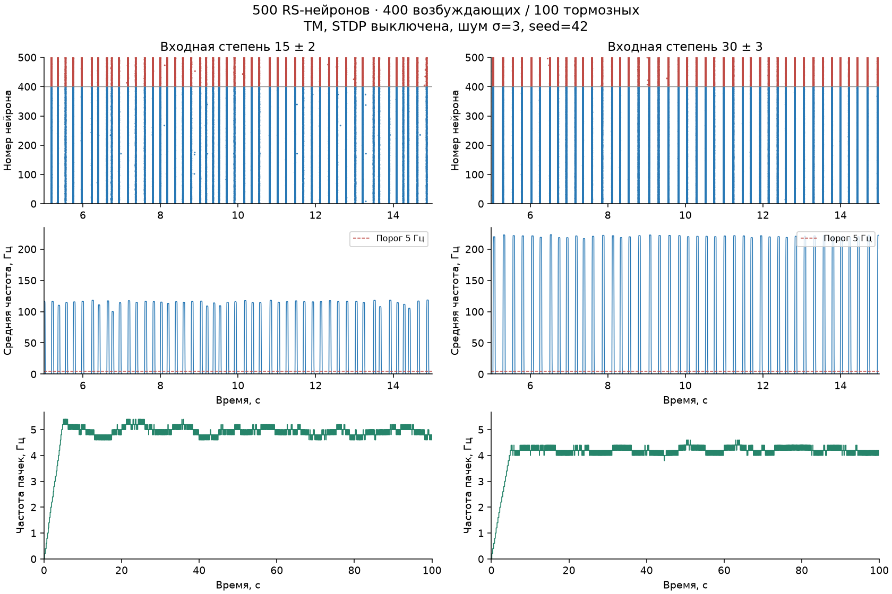

# Краткий отчёт по второй лабораторной работе

Выполнены 43 расчёта колец и 15 расчётов сетей из 500 нейронов. Получены затухание возбуждения, циркуляция в контрольном режиме и популяционные пачки. **Воспроизводимость внутри нашей модели подтверждена; полное количественное совпадение с NeuroNet не подтверждено.**

Использованы нейроны Ижикевича RS, синапсы Цодыкса–Маркрама с `g=20`, `U=0.5`, `τI=10 мс`, `τrec=50 мс`, `τfacil=1000 мс`. STDP выключена согласно заданию. Шаг RK4 — 25 мкс, контрольный — 12.5 мкс. [Полный протокол и команды запуска](README.md).

## Кольца и влияние веса

При нулевом шуме и одном стартовом импульсе кольца из 3–10 нейронов с TM и весом 1 дают по одному спайку на нейрон, затем затухают. Для кольца из 10 нейронов:

| Вес всех связей | Результат с TM за 5 с |
|---:|---|
| 1 | Один проход по кольцу; последний спайк на 137.125 мс |
| 0.7 | Один проход; последний спайк на 155.275 мс |
| 0.5, 0.2, 0 | Спайк только у стимулированного нейрона |

В контрольном опыте **без STP, с полным синаптическим выбросом**, при N=10 и w=0.7 циркуляция сохраняется до конца 5-секундной записи. Период возврата к тому же нейрону — **49.525 мс**, частота по межспайковому интервалу — **20.192 Гц**. Это отдельный режим, его нельзя выдавать за результат с включённой TM. При w=1 и без STP также возникает затухание после короткого всплеска: зависимость от веса не монотонна.

В TM-кольце первый возврат происходит при ещё повышенной переменной восстановления первого нейрона; ответ остаётся подпороговым. Состояния указывают на роль адаптации нейрона, а не истощения ещё не использованного входящего синапса. [Растры контрольных опытов](results/figures/rings_controls.png), [диагностика возврата](results/figures/rings_first_return.png).

## Сеть из 500 нейронов

Созданы сети из 400 возбуждающих и 100 тормозных нейронов, с модулями весов `0.5±0.1` и входной степенью `15±2` либо `30±3`. Гистограммы соответствуют заданной гауссовской выборке. При шуме σ=3, обновляемом каждые 1 мс, возникают популяционные пачки.

Результаты трёх seed (`11,42,101`), общее окно анализа 5–30 с; приведены среднее ± стандартное отклонение между запусками:

| Входная степень | Средняя частота спайков на нейрон, Гц | Частота популяционных пачек, Гц |
|---|---:|---:|
| 15±2 | 28.727±0.442 | 4.933±0.023 |
| 30±3 | 46.645±0.386 | 4.200±0.040 |

Большая связность повышает среднюю частоту спайков, но снижает частоту пачек в этих опытах. Тот же порядок сохраняется при контрольной топологии ближайших соседей. Для seed=42 записано по 100 с. Частота сети считается в окне 50 мс; пачки — пики выше 5 Гц с минимальным расстоянием 50 мс, их частота — в окне 5 с. Изменение расстояния на 25 или 100 мс не меняет направления сравнения.

[Гистограммы связей](results/figures/populations_distributions.png), [численные результаты](results/populations/metrics.json).

## Проверки и вывод

Повтор идентичного опыта дал побайтово одинаковые CSV. Независимый анализ событий подтвердил все сетевые характеристики. При уменьшении шага средняя частота больших сетей изменилась на **0.19% и 0.34%**, оценка частоты пачек сохранилась; отдельные спайковые последовательности при этом различаются. В основных опытах с кольцами число спайков и характер затухания сохранились. Контроль без шума и внешнего запуска не дал спайков.

Пакетный исполнитель для 500 нейронов сопоставлен с основным ядром в 24 малых сценариях на каждом из 171 392 шагов. Экспорт графического конфигуратора для циркулирующего кольца побайтово совпал с CLI. Эти проверки подтверждают согласованность вычислений в проверенных режимах. Интерфейс сохраняет лимит 16 нейронов; большие сети рассчитаны отдельным пакетным исполнителем с теми же уравнениями.

**Сравнение с методичкой остаётся частичным.** Циркуляция с TM в выбранном протоколе не получена, а частоты пачек около 4–5 Гц не совпадают с иллюстрацией около 0.9 Гц на с.22. В пособии не определены seed, точный алгоритм соседства, генератор шума и детектор пачек; наш численный шаг отличается от показанного на скриншотах, задержки проведения в нашей модели отсутствуют. Поэтому результаты нельзя представлять как точную копию NeuroNet или как доказательство ошибочности одной из программ.
