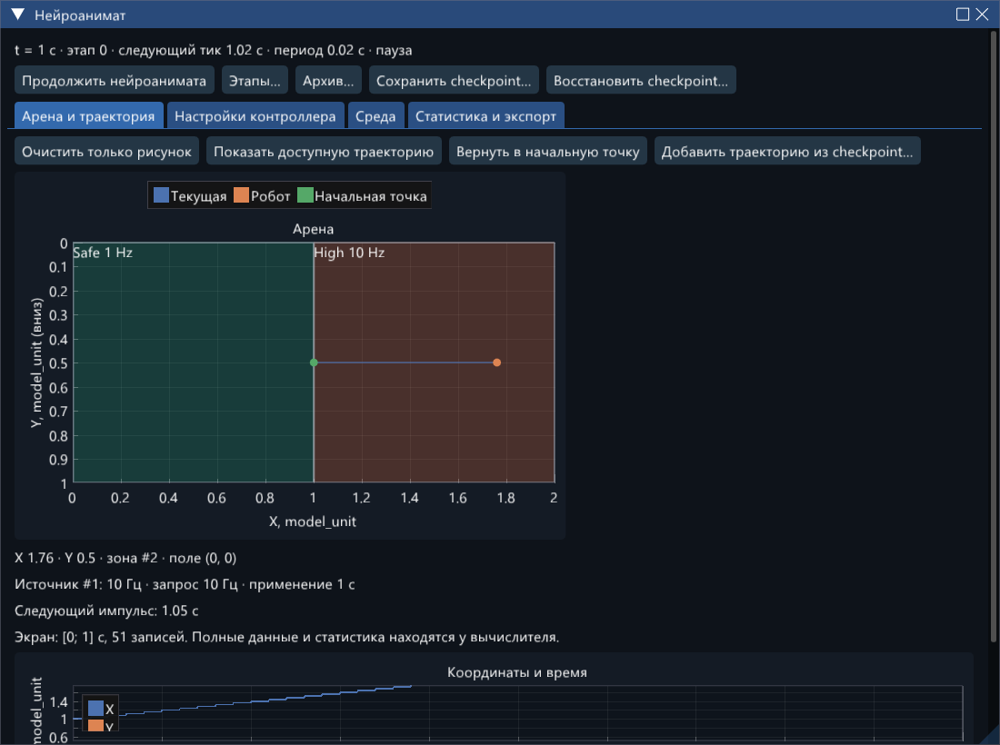
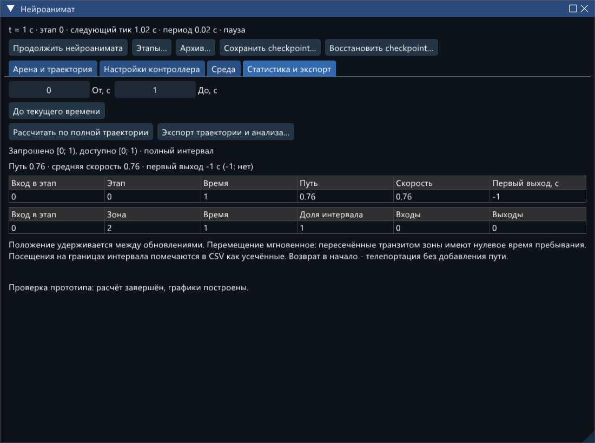

# Нейроанимат: движение, обучение и смена среды

Окно **«Нейроанимат…»** связывает один робот с существующим пространственным
стимулятором и полем активности сети. Это замкнутый контур: положение определяет
получателей и частоту входа, события сети формируют поле, поле задаёт следующее
перемещение. Используется тот же `Simulator`, решатель, очередь доставок, STDP,
планировщик стимулов и `SimulationRunner`, что и в обычном опыте.



Это инструмент исследования. В нём нет встроенного критерия «правильного»
поведения, вознаграждения или гарантии избегания зоны 10 Гц. Снижение времени
в такой зоне нужно проверять по независимым ветвям и повторениям; само движение
не доказывает пространственную память.

## Быстрый старт в GUI

Для новой копии репозитория сначала соберите ветку
`feature/neuroanimat-20261020` по [инструкции в основном README](../README.md#быстрый-старт-из-этого-репозитория).
Исходники функции опубликованы коммитом `17bef99`; старые готовые релизы
не следует считать сборкой нейроанимата. Пути ниже указаны относительно корня
репозитория `E:/asp/26_27/configurator`.

1. Запустите `build/Release/network_studio.exe`. Нажмите **«Нейроанимат…»**.
2. На вкладке **«Настройки контроллера»** выберите **«Минимальный пример
   (сброс)»** либо откройте `neuroanimat/examples/minimal.json` обычной командой
   открытия конфигурации. Пример содержит два нейрона Ижикевича и направленную
   TM-связь. Ток 6 и геометрия явно записаны в JSON; пример проверяет движение,
   а не обучение.
3. На вкладке арены нажмите **«Продолжить нейроанимата»**. Видны робот,
   начальная точка, зоны, траектория, координаты по времени, действующая
   и запрошенная частоты. Окно можно закреплять и выносить на другой монитор.
4. **Пауза → Среда** позволяет менять прямоугольники, круги, приоритеты,
   частоты, радиус, амплитуду и включение источника. Применение проходит через
   очередь команд на безопасной границе; веса и состояния сети сохраняются.
5. На вкладке статистики задайте **«От»** и **«До»**, нажмите
   **«Рассчитать по полной траектории»**. Интервал не связан с масштабом графика.
   Показаны запрошенная и доступная части; неполнота обозначается явно.
6. **«Экспорт траектории и анализа…»** сохраняет данные, настройки и протокол.
   **«Сохранить checkpoint…»** сохраняет эксперимент для продолжения.
   Загрузка оставляет его на паузе.

Для обучения откройте `neuroanimat/examples/spatial_learning.json`:
60 нейронов (48 E / 12 I), пространственный отбор связей, TM, STDP, шум σ=3,
seed 42, арена 2×1 `model_unit`. В **«Этапы…»** нажмите
**«Выполнить отсюда до конца»** у первого этапа. Четыре этапа по 1 с:
наблюдение с замороженными весами, обучение, проверка с замороженными весами,
перестановка частот зон и повторное обучение. Это короткая демонстрация.

Размеры арены, исходное положение, параметры поля и контроллера относятся
к научной конфигурации. Их применение из окна настроек **сбрасывает опыт**.
Визуальные стрелки, камера и очистка рисунка не меняют контроллер.
План этапов фиксируется после первого шага; для его редактирования нужен сброс.
Изменение среды во время опыта выполняется отдельной зарегистрированной командой.
Связанный источник и геометрию нейронов нельзя незаметно перемещать обычным
инспектором во время такого опыта.

## Координаты и закон движения

Арена использует уже имеющуюся `Config.space`: ширину W, высоту H и строку единиц.
У этих единиц нет автоматически назначенного физического масштаба.
Координаты нейронов `(px,py)` нормированы на [0,1]²; на арене это `(W·px,H·py)`.
Ось Y направлена вниз, как на схеме сети. Экранные пиксели в вычисления не входят.
Круг пространственного отбора имеет радиус в единицах арены; при прямоугольной
арене он не заменяется кругом в нормированных координатах.

Контроллер читает штатное поле активности в ячейке текущего положения.
Направление поля вычислено в нормированной плоскости сети. Для физического
перемещения применяется преобразование:

`Δ = gain · (W·vector_x, H·vector_y)`.

Поэтому при W≠H направление на физической арене нужно сравнивать с
преобразованным вектором, а не с углом стрелки в нормированном квадрате.
Длина Δ ограничивается `max_displacement`; затем применяется граница арены.
В журнале `requested_dx/dy` — запрос после ограничения длины, до ограничения
границей; `actual_dx/dy` — реально выполненное перемещение.

* **Обрезать компоненты:** новая X/Y ограничивается диапазоном арены.
* **Отменить выходящее перемещение:** весь выходящий шаг отвергается.
* **Нет активности → остаться:** базовый режим, без случайного блуждания.
* **Повторить последнее:** явно выбранная дополнительная модель; повторяется
  последнее ненулевое ограниченное перемещение.

Порог нулевого вектора применяется к модулю в нормированной плоскости.
Интервал контроллера задаётся в модельных секундах и округляется вверх до целого
числа основных шагов `dt` (с поправкой только на представление целого отношения
в double). Фактическое число шагов `period_steps` входит в экспорт и checkpoint.
Первое перемещение — после этого интервала, не при инициализации.
Для включённого нейроанимата конечное время (в том числе продление) должно
лежать на целой границе dt. Иначе короткий последний шаг мог бы преждевременно
выполнить тик. Неподходящее время отклоняется, а не округляется скрытно.
Изменение частоты GUI не меняет число обновлений.

**Движение дискретное:** положение удерживается между обновлениями, перемещение
происходит мгновенно в их модельные моменты. Рисуемая линия соединяет точки,
но не вводит постоянную скорость между ними.

## Поле, зоны и стимулы

Используются существующие критерии:

* **доставки:** связь активна, если в окне поля была доставка;
* **доставки с последующим ответом:** требуется последующий спайк принимающего
  нейрона в заданном временном окне. Совпадение по времени не доказывает
  причинность; одновременный спайк не считается последующим.

Каждая активная связь даёт вклад один раз, с модулем текущего веса и направлением
связи. Повторные доставки поддерживают активность, но не умножают вклад на число
событий. Фильтры E/I, модель связи, сетка, окно событий и окно ответа сохраняются
в `Config.animat.field`. Настройки визуального поля окна схемы независимы.
Если требуемая история активности недоступна, расчёт останавливается с ошибкой,
а не заменяет поле нулём.

Прямоугольники: `[x,x+width) × [y,y+height)`. Совпадающий с внешним краем арены
правый/нижний край включён. Круг: центр `(x,y)`, радиус `width`, граница включена.
Зоны должны целиком помещаться в арене. При перекрытии выигрывает больший
приоритет, затем меньший устойчивый ID; порядок строк редактора не влияет.
ID 0 означает область вне зон. Частоты 1 и 10 Гц — редактируемые настройки
примеров, а не скрытая константа.

Положение центра и радиус используют существующий пространственный отбор
получателей. Частота меняется **без сброса фазы**: до первого импульса его
запланированное время сохраняется; после начала поезда завершается текущий период.
Более новый запрос зоны заменяет ещё не исполненный запрос частоты контроллера.
Положение, радиус, амплитуда и включение меняются сразу на принятой границе.
Отключение обрывает действующий сигнал согласно штатному планировщику.

Перемещение во время импульса может изменить получателей оставшейся части
импульса; это физическое изменение пространственного входа, а не новый импульс
источника. Штатный журнал общих импульсов содержит получателей **при начале**
импульса. Для восстановления динамического распределения входа используйте
также положение, радиус, фазу и амплитуду в полном журнале нейроанимата.
Контролируемый источник использует одиночный импульс в периоде; таблицы импульсов
для него в этом режиме не поддерживаются.

## Порядок событий и действия

На окончании основного шага сначала завершаются обычные интегрирование,
локализация порогов, сбросы, доставки, скачки ресурсов, STDP и запись состояния.
Внутренние правила одновременных пре-/постсобытий сохранены.
Затем выполняются автоматический переход этапа, оставшиеся команды источников
на этой границе, обновление контроллера и зарегистрированные пользовательские
действия `(time, sequence)`. Команда, поданная человеком после завершённого
обновления, воспроизводится **после** этого же обновления.
Источники синхронизируются; новые входные значения действуют на следующий участок
интегрирования. Контроллер видит уже обработанные доставки и спайки.
Импульсы сохраняют семантику `[start,stop)`. Запись дискового блока выполняется
после всей безопасной границы.

| Действие | Время и сеть | Робот, источник и журналы |
|---|---|---|
| Очистить только рисунок | Не меняются | Меняется только фильтр видимой траектории |
| Вернуть в начальную точку | Время, веса, ресурсы, следы сохраняются | Телепортация; пересчёт источника, команда и строка журнала; часы контроллера сохраняются |
| Войти в этап | Динамика сохраняется; применяются флаг и скорость обучения | По плану меняется среда/положение (сохранить, начальное или заданные X/Y); увеличивается номер входа в этап |
| Продолжить без этапа | Снимается условие остановки этапа | Положение и вход сохраняются; действие регистрируется |
| Восстановить checkpoint | Полностью заменяется сохранённым опытом | Восстанавливаются очередь, положение, следующий тик и история; пауза |
| Сброс | t=0, исходные состояния и веса Config | Начальная точка и среда, исходная фаза связанного источника, новые журналы |

Заморозка STDP сохраняет веса. Следы продолжают эволюционировать; STP/TM
и остальная динамика работают. Очистка следов — отдельное явное действие.
У этапа можно включить сохранение результатов: при входе и выходе копируются
состояния **всех** объектов, веса и три следа каждого синапса, независимо
от политики выборочной записи. Они входят в checkpoint и отдельный CSV.
Это снимки результатов, не автоматическая запись файлов checkpoint на каждом этапе.

## Журналы, статистика и продолжение

Полная траектория хранится у вычислителя независимо от экранного хвоста
(до 20 000 строк). При включённой штатной дисковой записи строки нейроанимата
и версии среды попадают в тот же архив; сбои записи не игнорируются.

Обычный экспорт дополнительно создаёт:

* `_animat.csv` — координаты, зона, этап и номер входа, вектор, запрос/факт
  перемещения, фаза и параметры источника, обучение;
* `_animat_actions.json` — принятые и ожидающие пользовательские действия;
* `_animat_initial.json` — начальная Config для воспроизведения;
* `_animat_experiment.json` — текущая Config, версии среды, seed, алгоритм,
  идентификатор сборки, потоки и фактический период контроллера;
* `_animat_zones.csv`, `_animat_visits.csv`, `_animat_crossings.csv`,
  `_animat_stages.csv`, `_animat_analysis.json` — анализ;
* `_animat_stage_states.csv` — отмеченные снимки состояний и пластичности.
  Индексы `weight_pre_post_slow` идут группами по четыре значения на связь.

В строках траектории `kind`: 0 — инициализация, 1 — тик, 2 — возврат,
3 — среда, 4 — этап/обучение, 5 — принятие отложенной частоты.
В файле действий своя типизация `kind`: 0 — среда, 1 — возврат, 2 — этап,
3 — обучение, 4 — продолжить без этапа. ID `sequence` — десятичная строка uint64.
В архивном экспорте версии среды содержат `version` и `context`: повторный
контекст при начале ветви не является новым изменением среды.



Анализ использует `[от,до)`: перемещение точно на левой границе учитывается
в пути и входах/выходах, на правой — не учитывается. Время пребывания считается
по удерживаемому положению. Геометрические пересечения отрезка упорядочены
по доле его длины, имеют одно модельное время обновления и нулевое время транзита.
Касание границы в изолированной промежуточной точке не считается посещением.
Пересечение конечной точкой определяется правилом принадлежности зоны.
Возврат в начало и перемещение этапом — телепортации, в длину пути не входят.
Смена геометрии может изменить принадлежность без движения — это отдельно
помеченный переход.

Посещения пересекающие выбранный интервал отмечаются `left_censored` /
`right_censored`; последнее незавершённое посещение не выдаётся за завершённое.
При разделении по этапам граница этапа также цензурирует посещение.
Первый выход измеряется от левой границы анализа при старте в зоне;
`-1` означает «не наблюдался / старт вне зон». Средняя скорость = путь /
доступная длительность. Доли даются как от всего интервала, так и от доступного
времени конкретного этапа.

Сравнительные траектории загружаются из совместимых checkpoint: до четырёх
наложений, одинаковые размеры/единицы арены, одинаковый масштаб. Показан только
экранный хвост каждого; полный анализ нужно экспортировать из соответствующего
опыта. Разные зоны/параметры не объявляются одинаковыми условиями.

## CLI и воспроизводимые ветви

Из корня проекта; для результатов выбирайте новые каталоги:

```powershell
New-Item -ItemType Directory verification/animat_manual
build/Release/network_studio_cli.exe --config neuroanimat/examples/minimal.json `
  --stop-at 0.4 --checkpoint verification/animat_manual/common.nscp `
  --output verification/animat_manual/common
build/Release/network_studio_cli.exe --resume verification/animat_manual/common.nscp `
  --threads 6 --output verification/animat_manual/resumed `
  --checkpoint verification/animat_manual/final.nscp

build/Release/network_studio_cli.exe --config neuroanimat/examples/spatial_learning.json `
  --sequence 0 --output verification/animat_manual/stages `
  --checkpoint verification/animat_manual/stages.nscp
```

Повтор команд: `--config PREFIX_animat_initial.json --animat-commands
PREFIX_animat_actions.json`. Не добавляйте одновременно `--sequence 0`, если
вход в этап уже есть в журнале действий. Времена команд абсолютные, в секундах;
`--stop-at`, `--until`, `--animat-from`, `--animat-to` также абсолютные.
`--run-for` — длительность продолжения. Будущие команды принимаются на следующей
границе основного шага; в экспорт попадает принятое время.
Для ветвей загрузите один checkpoint в разные процессы и задайте разные файлы
`--animat-commands`. Не используйте один выходной каталог для разных ветвей.
При наличии архива создавайте новую ветвь `--archive NEW_DIRECTORY`; исходные
архивы родителей нужны для полной истории. `--archive-append` требует точного
совпадения checkpoint с последней подтверждённой границей.

`neuroanimat/run_demo.py` автоматизирует короткий опыт, повторы, замеры и ветви
из одного состояния через штатный CLI. Общий участок длится 0,1 с, ветви
без стимуляции / 1 / 10 Гц продолжаются до 1,4 с: это позволяет дождаться
границы исходного периода 1 Гц. Ни один лабораторный файл не изменяется.

```powershell
C:/Python313/python.exe -X utf8 neuroanimat/run_demo.py `
  --output verification/animat_demo_new --repeats 3
C:/Python313/python.exe -X utf8 neuroanimat/verify_demo.py `
  verification/animat_demo_new
```
Команды и контрольные суммы сохраняются с результатами. Второй скрипт независимо
пересчитывает перемещения и время пребывания по экспортированным строкам,
проверяет неизменность замороженных и тормозных весов.
[Выполненные проверки, измерения и наблюдаемое поведение](REPORT_RU.md).

## Формат и ограничения

* Config **JSON 9** читает предыдущие JSON 1–8; отсутствие `animat` означает
  выключенный контроллер. Обычные модели и их численные настройки сохранены.
* Checkpoint **NSCP 7**, алгоритм
  `event-rk4-doubling-exact-linear-localized-stimulators-animat-v5`.
  Проверка точного fingerprint сборки сохранена. NSCP 7 дополнительно хранит
  накопительные счётчики принятых внутренних шагов и отклонённых попыток.
  Старые NSCP 1–6 открывайте исходным EXE; обхода совместимости нет.
  [Текущие правила шага и диагностики](../performance/20261020_step_range/README_RU.md).
  Отчёт нейроанимата описывает прежнюю сборку с NSCP 6.
* В NSCP сохраняются исходная Config, положение, последний вектор перемещения,
  следующий номер шага, очередь действий и источников, стадии, полная траектория,
  версии среды и снимки результатов. Кэши поля пересоздаются из сохранённого окна
  событий. Прочие состояния решателя, включая пороговые защёлки, сохраняются
  прежним checkpoint API. Файл после вычислительной ошибки не допускает продолжения.
* Архив **NSH 2** добавляет типы записей 7/8: движение и среду. Новый читатель
  понимает NSH 1/2; прежний читатель не должен использоваться для нового архива.
* Один робот, до 64 зон, 4096 действий/версий среды, 1 млн полных строк
  траектории, 512 снимков этапов / 8 млн double в них. Лимит вызывает явную
  остановку; данные не прореживаются скрытно. Общий предел checkpoint — 512 МиБ.
  Диск не освобождает память полной траектории робота в этой версии.
* Сетка поля кусочно постоянная; это не непрерывная механика и не модель
  столкновений. Зоны управляют стимуляцией, не являются препятствиями.
* Протокол нейроанимата воспроизводит среду, возвраты, входы в этапы, обучение
  и снятие этапа. Изменения произвольной топологии во время опыта не поддержаны.
  Начальную Config и журнал нужно хранить вместе.
* Численная эквивалентность проверяется в одной совместимой сборке и окружении.
  Биологическая достоверность, полезность обучения и устойчивость поведения
  на длинных сериях требуют отдельных исследований.
