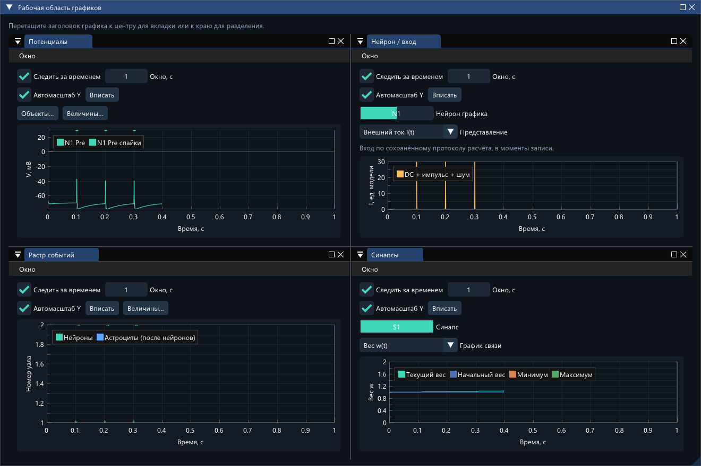

# Независимые окна графиков — 14.10.2026

Рабочая ветка: `feature/independent-plot-windows`, основана на `a4a218c1b637ed0686bde0e58b1cbf5155af91d0`. Перед работой дерево было чистым; локальных AGENTS.md не обнаружено. Исторические отчёты сохранены. CUDA и исходный каталог cudaynamics для сборки не нужны.

## Реализация

Из cudaynamics заимствована архитектурная идея коллекции состояний представления и цикла платформенных окон. `PlotWindowState` хранит ID, название, тип, объекты, величины, диапазоны осей, слежение и геометрию. `PlotWindows` управляет коллекцией с отложенным добавлением/удалением при отрисовке. Общая `draw_view(const Simulator&)` обслуживает встроенные вкладки и отдельные окна. Ни указатели на объекты сети, ни копии History в окнах не сохраняются. Изменяемое название отделено от ID через `###studio_plot_<id>`.

Перенесены потенциалы и маркеры спайков HH/Ижикевича, семь астроцитарных переменных, растр генераций/выбросов, синаптические ресурсы, активация, глутамат, ток и веса, вход, u и фазовые портреты; доставки показаны отдельной таблицей с `t_emit` и `t_arrival`. Для вычисляемых рядов используются функции доступа к общей истории. Источник параметров — конфигурация соответствующего Simulator.

Включены docking и multi-viewport Win32/DX11. Отдельные HWND не принадлежат главному окну; цикл платформенных окон работает и при свёрнутом главном. Для WM_DPICHANGED добавлен локальный адаптер: поставляемый Win32 backend не применял предложенный Windows прямоугольник. Платформенные окна уничтожаются до освобождения backends и контекста. Редактор сети сохраняет прежнюю встроенную панель.

`.nsworkspace`, версия 1, хранит настройки и ImGui ini отдельно от Config/checkpoint: ограниченные длины, проверка типа/версии/чисел/ID и контрольная сумма, атомарная замена. При ошибке загрузки действующие окна остаются на месте. Привязка к отпечатку протокола предотвращает переназначение по совпавшему индексу после смены сети; перепривязка требует явной команды. Сброс/совместимый checkpoint сохраняют выбор. Координаты схемы и продлеваемый конец опыта исключены из отпечатка.

## Проверки

- Штатная команда `powershell -ExecutionPolicy Bypass -File .\build.ps1 -Test -Smoke`: **11/11 CTest за 181,84 с**, плюс обычный графический smoke. Добавлены `plot_windows_and_workspace` и `win32_dx11_plot_viewports`. После завершающей правки повторного включения автосохранения при явной замене повреждённого пространства повторены все три GUI-теста (3/3 за 18,24 с); после обработки пути без каталога — Win32/DX11 с новым процессом (1/1) и smoke окончательной сборки.
- GUI-взаимодействия проверяют меню создания и независимость дубликата. Отдельные тесты проверяют закрытие, стабильность ID после переименования, оси и сериализацию, отмену/ошибку загрузки, усечённые/повреждённые/несовместимые/слишком большие файлы, кириллический путь, восстановление после reset/checkpoint, удаление объекта и замену сети.
- Полные бинарные checkpoint **побайтово совпали** с контрольным Simulator до и после рисования, операций над окнами, сохранения пространства и продолжения с одинаковым числом шагов. Сравнение включает состояние, вес/следы, очередь задержанных доставок, thresholds, адаптивный интегратор, счётчики и историю. В контрольной конфигурации есть шум, STDP, выборочная запись и непустая очередь.
- Большая записанная сеть: **100 нейронов, 400 связей, 2001 отсчёт, 8 окон**; 20 последовательных отрисовок. Проверено сохранение адресов общих массивов и числа отсчётов; код графиков не копирует ряды. Измерение: 59,25 мс на 20 кадров (~2,96 мс/кадр, без графического backend; это не оценка полной скорости приложения).
- Реальный Win32/DX11: **31 проверка в каждом из двух процессов**. Проверены четыре отдельных видимых HWND, собственные DX11 поверхности и непустая геометрия, работа со свёрнутым главным окном, продолжение расчёта, resize, клавиатурный фокус, перенос на второй монитор, обработка DPI-прямоугольника, docking в четыре области и во вкладки, закрытие WM_CLOSE и очистка платформенных окон. Второй процесс читает сохранённое первым рабочее пространство. В окружении обнаружены **два монитора**.
- Снимки отдельных swapchain и общей области просмотрены; элементы управления в узких окнах перенесены на дополнительные строки. CLI и файлы численного ядра не изменены; SHA-256 CLI совпадает с предыдущей проверенной сборкой.

Логи финального прогона: `verification/plot_windows_20261014/release_build_test_smoke.log`; обычный smoke: `verification/plot_windows_20261014/release_smoke/`. Отдельная проверка запуска двух процессов: `verification/plot_windows_20261014/release_native/20261014_171854/{first,restart}/`; в каждом каталоге — `renderer.txt`, PNG окон и `plots.nsworkspace`. Новые тестовые данные не заменяют результаты аудита модели.

Повторные проверки окончательной сборки: `checked_gui_tests.log`, `final_checked_build.log`, `final_native_test.log`, `final_checked_smoke/` в том же каталоге verification. Последний запуск двух процессов: `build/native/viewport-smoke/20261014_172428/{first,restart}/`.

## Пример

Откройте `examples/plot_windows_demo.cmd`, затем нажмите «Запуск». Используется `examples/stdp_potentiation.json`, одновременно открываются потенциал N1, вход N1, растр и вес S1. Графики можно вытянуть из области docking на другой монитор. Аналогичная команда: `network_studio.exe examples/stdp_potentiation.json --plot-demo`.

## Ограничения

- До 32 независимых окон и до 32 рядов объектов в одном графике. Все окна принадлежат одному процессу; закрытие главного приложения завершает их.
- Рабочее пространство не содержит сам эксперимент. Оно привязано к протоколу; несовместимая сеть требует явного выбора новых объектов. Файл ограничен 4 МиБ, ini — 1 МиБ; docking рассчитан на поставляемую ImGui 1.91.5.
- Незаписанные состояния не подменяются текущими значениями. Внешний вход явно восстанавливается по сохранённому детерминированному протоколу только в моменты записи; он не является журналом внутренних подшагов.
- DPI-шрифт растрово масштабируется средствами этой версии ImGui. Проверены перенос между двумя доступными мониторами и обработка WM_DPICHANGED с 150%; физическое отключение монитора и разные аппаратные DPI отдельно не проверялись. Возврат окна из недоступных координат проверен автоматически.
- Время рисования зависит от числа видимых точек и окон; специального прореживания данных не добавлено. Проверки GUI и неизменности расчёта не оценивают биологическую достоверность модели.

## Сборка

GUI: `E:/asp/26_27/configurator/build/Release/network_studio.exe`

SHA-256: `4b53c676538cfcb343d16d22f6875715c71083efe89fea4a01b9d6d62d47cc73`

CLI: `E:/asp/26_27/configurator/build/Release/network_studio_cli.exe`

SHA-256: `48e4d8d345324ddf9b4d57d1f9723dff86c56159e0348a5b6a1be6d6f590ab41`
