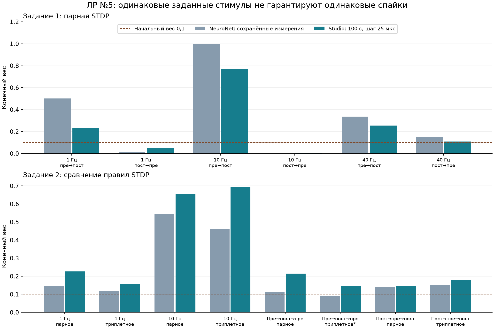

# Воспроизводимость лабораторной №5 и триплетная STDP

12 октября 2026. Четвёртая работа выполненной серии соответствует лабораторной №5 пособия, с. 24–27. Проверена Windows CPU-сборка Network Studio на ветке `feature/izhikevich-lab1`.

**Полное количественное воспроизведение результатов NeuroNet не достигнуто.** Парная STDP воспроизводит направления изменения веса в шести опытах задания 1. Добавлены минимальное триплетное правило и таблица импульсов, поэтому теперь доступны все протоколы задания 2. Их результаты сопоставлены ниже без подбора параметров к внешним конечным весам. Задание 3 показывает усиление прямой связи, но не устойчивое подавление обходного пути.

## Обновлённый конфигуратор

В инспекторе синапса и мастере создания сети доступно правило **«Триплетная (минимальная)»** с настраиваемым `tau slow`. Инспектор нейрона позволяет задать несколько интервалов внутри каждого периода. Все параметры сохраняются в JSON; прежние конфигурации читаются с прежними настройками парного правила и одиночного импульса.

Реализована формула (12) пособия: при постспайке `Δw+ = A+ (wmax−w) pre_fast post_slow`; при преспайке `Δw− = −A− (w−wmin) post_fast`. Следы берутся до добавления текущих событий. Медленный след увеличивается после обновления веса, поэтому первая изолированная пара без предыдущего постспайка не вызывает триплетного усиления. Такой порядок явно задан в [статье Pfister и Gerstner, 2006, уравнение 4](https://pmc.ncbi.nlm.nih.gov/articles/PMC6674434/). Здесь используется минимальная версия с мультипликативными границами из пособия, без отдельного парного слагаемого LTP и без синаптического забывания. Тождество внутреннему алгоритму NeuroNet SM R05 не предполагается.

Готовое приложение: [network_studio.exe](../../build/Release/network_studio.exe), обычный [launch.cmd](../../launch.cmd). Примеры: [парная стимуляция с триплетной STDP](../../examples/stdp_triplet.json) и [пост → пре → пост](../../examples/stdp_triplet_burst.json). В примерах оставлена ширина 3 мс, как в лабораторной.

## Общие условия сравнения

Два RS-нейрона Ижикевича `a=.02, b=.2, c=−65, d=8`, ток 25 единиц модели, ширина 3 мс, начальный вес 0,1, обучение 100 с. TM: `U=.5, τrec=50 мс, τI=10 мс, τfac=1000 мс`. Задание 1: gain 20, `A+=.001, A−=.005`; задание 2: gain 2, `A+=A−=.001`. Быстрые следы 10 мс, медленный 100 мс. Для лабораторной используется скорость .001 с.25 пособия, а не .01 из общего теоретического примера с.9. Noise=0 в заданиях 1–2.

Начальные состояния Studio заданы одинаково: `V=−65, u=−13`, ресурс TM восстановлен, следы STDP нулевые. Это контролируемый новый запуск, а не восстановление продолжающегося состояния NeuroNet. Каждый протокол рассчитан при 25 и 12,5 мкс. Спайки взяты из полного журнала событий; редкая запись напряжения не используется для подсчёта пиков.

## Задание 1

| Протокол | NeuroNet | Studio 25 мкс | Studio 12,5 мкс | Спайки пре/пост при 25 мкс |
|---|---:|---:|---:|---:|
| 1 Гц · пре → пост | 0.501333 | 0.23040331 | 0.230120881 | 200 / 200 |
| 1 Гц · пост → пре | 0.0157814 | 0.0472950684 | 0.0473115912 | 200 / 200 |
| 10 Гц · пре → пост | 0.999748 | 0.767311403 | 0.767737492 | 1500 / 1990 |
| 10 Гц · пост → пре | 8.03577e-05 | 0.000775030559 | 0.000875405264 | 1500 / 1500 |
| 40 Гц · пре → пост | 0.335617 | 0.255283163 | 0.255312113 | 4001 / 4001 |
| 40 Гц · пост → пре | 0.153155 | 0.108956317 | 0.108956315 | 4001 / 4001 |

При 1 и 10 Гц порядок пре → пост усиливает связь, обратный ослабляет; при 40 Гц оба порядка дают усиление. Это качественное совпадение с внешними опытами. Численные веса отличаются. Например, при 10 Гц пре → пост NeuroNet дал 0,999748, Studio — 0.767311403.

## Задание 2

| Протокол | NeuroNet | Studio 25 мкс | Studio 12,5 мкс | Спайки пре/пост при 25 мкс |
|---|---:|---:|---:|---:|
| 1 Гц · парное | 0.147829 | 0.225753723 | 0.225584435 | 200 / 200 |
| 1 Гц · триплетное | 0.119444 | 0.156282731 | 0.156211206 | 200 / 200 |
| 10 Гц · парное | 0.5437 | 0.656555658 | 0.657403021 | 1500 / 1500 |
| 10 Гц · триплетное | 0.459589 | 0.694626428 | 0.69578471 | 1500 / 1500 |
| Пре → пост → пре · парное | 0.1141 | 0.214968166 | 0.214824197 | 300 / 200 |
| Пре → пост → пре · триплетное* | 0.0887917 | 0.147570114 | 0.147490035 | 300 / 200 |
| Пост → пре → пост · парное | 0.141625 | 0.145131242 | 0.144995297 | 200 / 300 |
| Пост → пре → пост · триплетное | 0.1523 | 0.180505992 | 0.180259293 | 200 / 300 |

В первых четырёх строках — парная стимуляция пре → пост; в остальных — тройки с частотой 1 Гц и интервалами 10 мс. «Парное/триплетное» обозначает правило обучения, а не количество внешних импульсов.

**Есть и качественные расхождения.** При 10 Гц триплетное правило в Studio даёт больший вес, чем парное (0,694626 против 0,656556), а в NeuroNet — меньший (0,459589 против 0,5437). При пре → пост → пре Studio получает усиление до 0,147570; внешнее ослабление до 0,0887917 не воспроизведено, с оговоркой о подтверждении режима исходного опыта. При пост → пре → пост в обеих программах триплетный вес выше парного.

*Внешний результат 0,0887917 предварительно отнесён к триплетному правилу: флажок виден до и после опыта, но его непрерывное состояние на всём запуске не зафиксировано. В новом расчёте режим однозначно задан конфигурацией.



## Задание 3

Исследованы две клетки, цепочка 1→2→3 и цепочка с прямой 1→3. Для каждой схемы выполнено десять запусков с согласованными seed 0–9 при σ=3 и удержании шума 1 мс. Начальные веса 0,1; стимулируется только первый нейрон, 25×3 мс, 10 Гц. Это заданный процесс шума Studio; совпадение его закона и реализации с NeuroNet не установлено.

За 5 с прямой вес в Studio составил **0,101444 в среднем**, диапазон **0,100323–0,103909**. При добавлении прямой связи среднее число спайков третьего нейрона выросло с 0,9 до 3,5 за 5 с при одинаковых seed. Без шума два получателя молчат и все веса остаются 0,1. Обходная связь при шуме может усиливаться, ослабляться либо почти не меняться — устойчивое подавление обхода не получено.

Внешний прямой вес NeuroNet — **0,106812**, остальные два — 0,1. По найденным файлам разность отметок для опыта с двумя клетками равна 6,100 с, для прямого пути — 12,525 с; это не доказывает непрерывного обучения без изменений между снимками. Дополнительные 30 запусков проверили чувствительность к этим длительностям: при 12,525 с прямой вес Studio в среднем **0,103344**, диапазон **0,101933–0,105345**. Продление сближает числа, но не устанавливает воспроизведение внешней траектории. Контроль цепочки использует те же 12,525 с для сравнения топологий; это не восстановленная длительность исходного опыта цепочки.

В самом внешнем отчёте обходные связи также не ослабли. Поэтому нельзя объявить полностью воспроизведённым «правило кратчайшего пути» ни по одному только росту прямого веса, ни по наличию схемы с двумя путями. В тексте пособия с.27 есть опечатка: прямой путь к третьему нейрону должен быть 1→3, что подтверждается рисунком.

## Почему результаты расходятся

- **Разные фактические спайки.** При 25×3 мс и 1 Гц Studio даёт два спайка на импульс. При 10 Гц чередуются одиночные и двойные ответы; усиление связи добавляет постспайки. В исходных кадрах NeuroNet видны другие последовательности. STDP обучается по событиям, поэтому одинаковой таблицы стимулов недостаточно.
- **Разные стартовые состояния.** В сохранённых `.net` присутствуют уже активные нейроны, ненулевые ресурсы и очереди сигналов. Изменение веса на 0,1 не равно сбросу всей модели. Наличие отдельных снимков не восстанавливает полную историю каждого опыта.
- **Численный метод и проведение.** В исходных опытах Step=0,500 мс; в Studio — RK4 0,025/0,0125 мс. Метод NeuroNet не восстановлен. В нём указана скорость проведения и сохранены очереди Output; наша сеть передаёт события без задержек. Место отсчёта STDP — приход или генерация спайка — существенно.
- **Семантика NeuroNet частично неизвестна.** Имя поля `refractory_time=1` не доказывает жёсткой рефрактерности: GUI подписывает его `Spike showing`. Не подтверждены порядок обновления медленного следа в R05, генератор шума и непрерывные длительности всех опытов.

Уточнение шага не устраняет внешних расхождений. Наибольшая абсолютная разность конечных весов 25→12,5 мкс среди 14 протоколов — **0.00115828**. Для малого веса опыта 10 Гц пост → пре относительная разность около 13%; два шага не доказывают полной сходимости.

Отдельно рассчитаны восемь контролей с шириной **1 мс**. В парной стимуляции они дают по одному спайку на импульс: например, при 1 Гц итоговый вес парного правила 0,132599, триплетного — 0,1000015. Но в стимуляции тройками второй импульс того же нейрона уже не вызывает дополнительного спайка: получается 100/100 событий за 100 с вместо 200/100 либо 100/200. Поэтому эти четыре контроля не являются проверкой идеальных троек. Все данные — в [подробном разборе](updated/README_RU.md); они не заменяют исходные 3-миллисекундные опыты и не включены в таблицы внешней воспроизводимости выше.

## Проверка реализации и материалы

Автотесты включают аналитические триплеты, одновременные события, границы веса, сброс следов, старые JSON, таблицу стимулов и операции реального ImGui-интерфейса. Все четыре тестовых набора CTest пройдены. Дополнительно для 36 новых 100-секундных запусков вес независимо пересчитан по полным массивам прошлых событий: наибольшее расхождение **8.95e-14**. Это проверяет формулу на полученной активности, а не доказывает правильность каждого времени спайка или эквивалентность NeuroNet.

В 16 парных повторах новой сборки файлы напряжений, спайков и весов побайтово совпали с исходной сборкой. Отдельная проверка опубликованной сборки повторяет 12 сетевых случаев из задания 3; результаты и SHA — [release_network_check.json](release_network_check.json). Все 14 внешних весов независимо сверены с именованными `.net`, а не только переписаны со снимков.

CLI обновлённой сборки SHA256: `38e1a6a15f357fee98f0f674656de0e6e0332db68cdccf43267de5185ec8373f`. Идентификаторы исходников и бинарных файлов, журналы проверок и реестр артефактов фиксируются рядом с отчётом.

- [Исходные материалы и их ограничения](sources/README_RU.md), [реестр источников](sources/source_evidence.json).
- [Парные опыты исходной сборки](pairs/README_RU.md), [новые опыты и контроли](updated/README_RU.md).
- [Сетевые повторы по 5 с](paths/README_RU.md), [чувствительность к длительности](duration/findings.json).
- Точные входы: `updated/configs/`, `paths/configs/`, `duration/configs/`; полные локальные CSV: соответствующие `raw/`.

Повторить из папки `standalone/network_studio` после обычной сборки `./build.ps1 -Test`:

```powershell
$env:PYTHONPATH='E:/asp/26_27/tmp/python_deps'
$py='C:/Users/N1kit/.cache/codex-runtimes/codex-primary-runtime/dependencies/python/python.exe'
& $py -B reproducibility/lab5/updated/run_updated.py --run --workload all --cli build/Release/network_studio_cli.exe
& $py -B reproducibility/lab5/check_release_networks.py --cli build/Release/network_studio_cli.exe --expected-cli-sha256 38e1a6a15f357fee98f0f674656de0e6e0332db68cdccf43267de5185ec8373f
```

Исполнители не подменяют формулы по внешнему результату. При другом SHA бинарного файла сохраняйте результаты в отдельной копии каталога аудита. Старый CLI зафиксирован в `pairs/baseline/`; сырые CSV и бинарные копии остаются локально и не включены в Git. Для повторной проверки сохранённых новых расчётов используйте `--skip-run --workload all` вместо `--run`.
