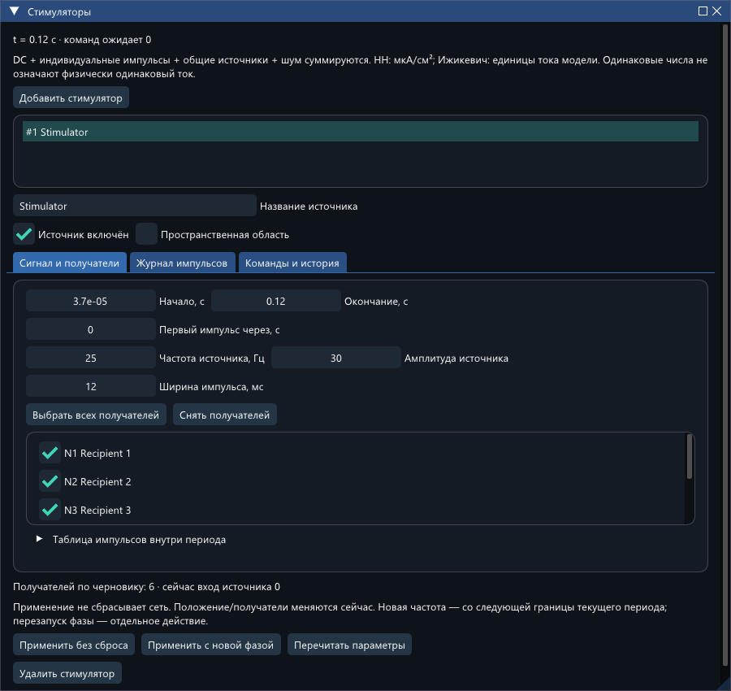
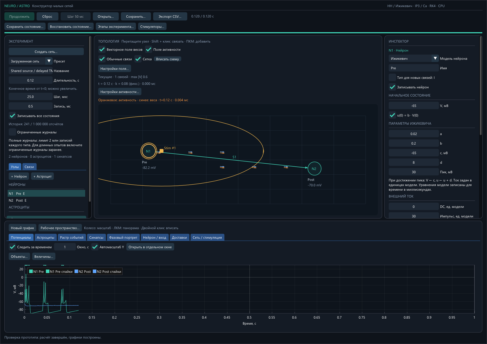
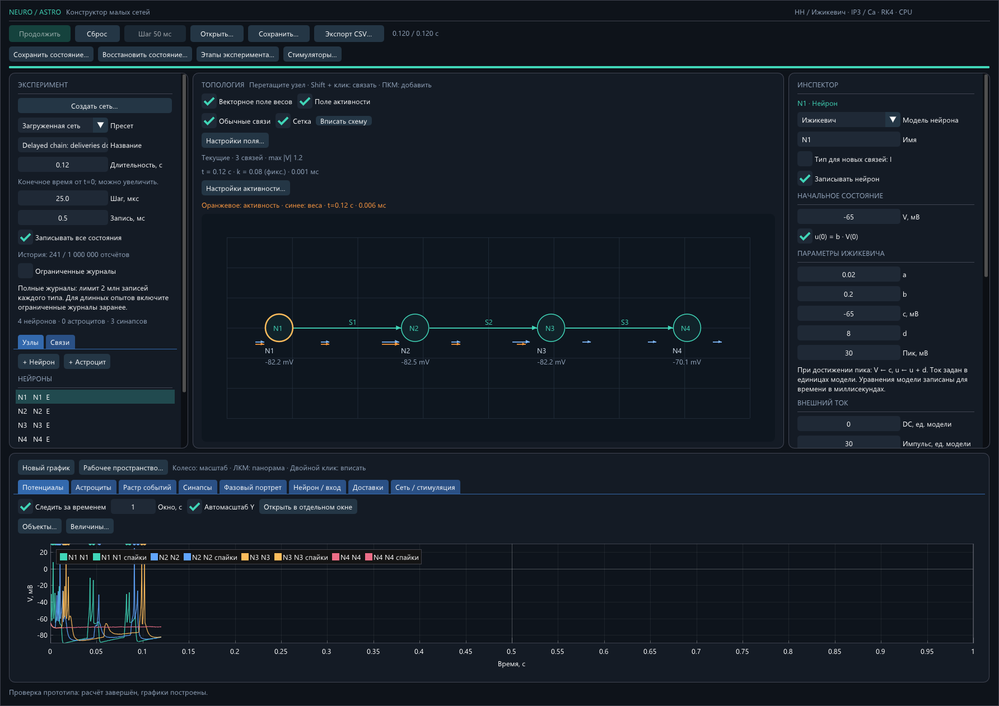

# Проверка общих/пространственных стимуляторов и поля активности

Дата: 18.10.2026. Ветка `feature/shared-stimulators-activity`, база `f47c00cc22c3`. Исторические отчёты предыдущих задач не перезаписывались.

## Реализация

Добавлен общий источник с постоянным ID, несколькими получателями, таблицей импульсов и пространственным выбором по кругу/типу. Изменение положения и параметров выполняется через очередь с абсолютным модельным временем, не сбрасывает сеть. Частота без явного перезапуска меняется на границе старого периода. Версии входов, активный импульс, будущие команды и окно событий сохраняются в checkpoint. Этапы и сетевой анализ используют ID источника.

Поле активности использует геометрию поля весов, текущие веса и отдельный ограниченный буфер событий. Два критерия — доставка и доставка с последующим постспайком. Каждая активная связь добавляется один раз за окно. Доступны фильтры, независимый масштаб, совместная отрисовка, сохранение настроек рабочего пространства. Контроллер получает `schedule_stimulator`, `move_stimulator`, `replay_stimulators`, `ActivityField::update/vector_at` без GUI; [контракт и примеры API](README_RU.md).

## Проверки

Финальная команда: `powershell -ExecutionPolicy Bypass -File .\build.ps1 -Test -Smoke`. Результат **22/22 CTest + штатный GUI smoke**. Финальный прогон CTest: 258,05 с с четырьмя параллельными заданиями; графические native-тесты последовательные. Предшествующий полный последовательный прогон также прошёл 22/22. [Лог](build_test_log.txt), [манифест и SHA-256](build_manifest.json).

| Проверка | Результат |
|---|---|
| Новые проверки источников/поля | 62610 проверок, PASS |
| Аналитический мембранный конденсатор, шесть получателей | dt 50 / 25 / 12,5 мкс; разные фазы и таблицы; ошибка напряжения ≤ 3·10⁻⁹ мВ |
| Сумма DC, индивидуального входа, двух общих и шума | точное соответствие заданному порядку |
| Радиус 40 мкм | внутри / на границе / снаружи; E/I; изменение положения нейрона |
| Движение во время импульса | тот же ID и окончание импульса; старый вход неизменен |
| Смена частоты | переход на старой периодической границе; 29 точных границ при 17 Гц |
| Поле | пустое окно, истечение, задержки, сложение/компенсация, частые события без умножения веса, несколько входов/один постспайк, отсутствие нулевой пары |
| Продолжение и отображение | повторные checkpoint для HH/Ижикевича, STP/экспоненциальных/TM, pair/triplet STDP, астроцита, шума и выборочной записи; конечные checkpoint побайтно одинаковы |
| Перезапуск процесса | 16 файлов состояния/экспорта побайтно одинаковы |
| Старые конфигурации | 8 пресетов × 5 CSV = 40/40 побайтно одинаковы с архивной сборкой; [хэши](legacy_comparison.json) |
| GUI | реальные ввод/клики/перетаскивание ImGui; создание/получатели/радиус/поля/удаление без сброса; workspace 1–4; native Win32/DX11 |

Перезапуск выполнен при t=0,0075000000000000006 с: первый общий импульс ещё активен, ожидают перемещения на 0,009013 и 0,061117 с, в очереди находится доставка от 0,0054305758473431973 к 0,0094435758473431983 с. После нового процесса расчёт до 0,12 с даёт те же ресурсы, следы, веса, историю и журналы, что непрерывный. Итоговые три импульса имеют начала 0,000037; 0,040037; 0,080037 с; перемещения не добавляют импульсы.

## Производительность

Отдельный запуск без параллельного набора CTest, Intel Core i9-11900KF, Windows x64, MSVC Release. Сеть 500 нейронов / 15000 связей, сетка 16×12. Это короткий тест инфраструктуры, не проверка 100–200 с модельного времени большой сети.

| Измерение | Значение |
|---|---:|
| Построение общей геометрии | 5.0634 мс |
| Учтённый объём кэша геометрии/весов | 1541892 байт |
| Среднее обновление двух полей, 100 вызовов | 0.696938 мс |
| Геометрия за эти вызовы | 1 построение |
| Повторное чтение обработанных событий на паузе | 0 |
| Расчёт 20 мс сети с общим пространственным входом | 6.85909 с реального времени |
| Реальных доставок в окне короткого расчёта | 39516 |

Для измерения суммирования использованы отдельно заданные 15000 доставок, чтобы все связи были активны. Это не время полного кадра DX11 и не обещание моделирования в реальном времени. Окно ограничено 250000 доставок и 250000 спайков; история потенциалов не копируется на кадре. Данные поля отделены от сокращаемой History.

## Примеры и независимый пересчёт

Все пять JSON-примеров выполнены: [результаты](example_results.json). В `shared.json` три импульса направлены шести нейронам; каждый дал восемь спайков за 0,12 с. В движущейся области — три импульса, спайки [6,5]. В цепочке — [8,7,6,0], 21 доставка: последний нейрон молчит при доставках по его входящей связи с нулевым gain. Это контроль отсутствия гарантированного ответа, не подобранная «успешность».

При 1/10 Гц за 2,03 с — 3/21 общий импульс, 40/202 доставки. В последнем окне 50 мс по трём связям — [4,5,5] / [3,3,3] доставок. При обоих частотах коэффициенты поля доставок [0,6;0,6;0,6], а поля с ответом [0,6;0,6;0]: частота не умножает вклад. Независимый пересчёт CSV: [activity_reference.json](activity_reference.json). Повторение с Python без дополнительных пакетов: `python stimulation/check_examples.py`; результаты пишутся в новый каталог `build/source-examples-*`.

## Ограничения и совместимость

Ответ после доставки не доказывает причинность и не измеряет торможение. Историческая перемотка поля отсутствует; используется текущий вес и текущее модельное время. Направления поля, как у прежнего поля весов, нормализованы по осям схемы; не являются физической скоростью в пространстве с разными шириной/высотой. Амплитуды HH и Ижикевича имеют разную интерпретацию.

До 64 источников, до 4096 команд/изменений и версий протокола. Длинные журналы событий поддерживают прежний ограниченный режим; протокольный журнал не потоковый. При недостаточном сохранённом окне поле явно недоступно. Полное окно по умолчанию 1 с, настраивается в Config до запуска. Старые checkpoint несовместимы: новые schema=4 и fingerprint решателя. JSON 1–6 и workspace 1–3 читаются; новые версии 7 и 4 соответственно. Не заявляется совпадение с NeuroNet или биологическая достоверность.

## Сборка

GUI: `E:/asp/26_27/configurator/build/Release/network_studio.exe`
SHA-256: `21d5198345c9c87a285ea91aeee7828a137caead0d7bea860271cda9297d7f36`

CLI: `E:/asp/26_27/configurator/build/Release/network_studio_cli.exe`
SHA-256: `7c76bd24921d97df57f26f0a161e9e2ca4f41f0d8d6070288601c1531fa663e6`

## Снимки реального Win32/DX11

Общий источник с шестью получателями:

Пространственная область 40 мкм и выделенный получатель (статическая конфигурация):

Совместное отображение синего поля весов и оранжевого поля доставок с ответом (окно 100 мс). Последний получатель не спайкует: у его связи остаётся только синее поле:

